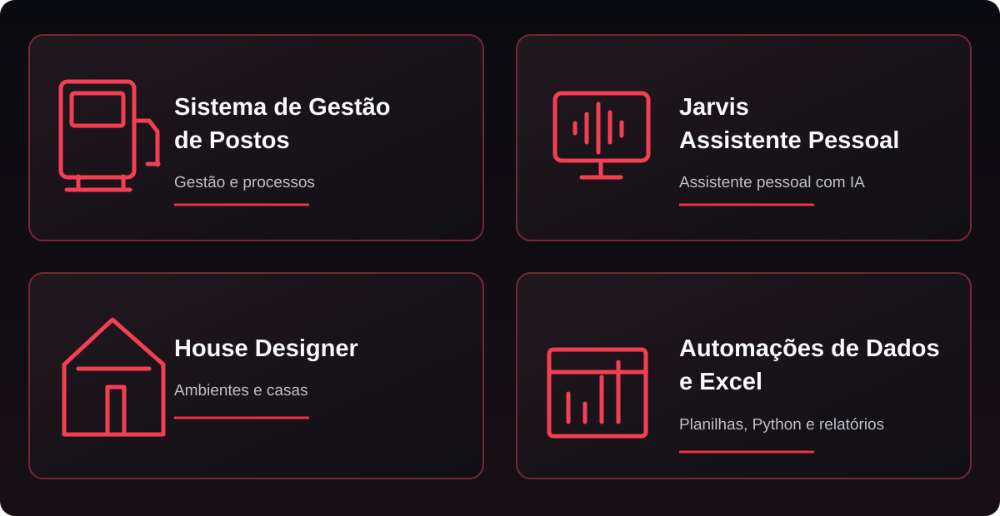

**Contabilidade como profissão. Tecnologia como ferramenta. Curiosidade como motivação.**

---

## Sobre mim

Sou formado em **Ciências Contábeis pela Universidade Estadual da Paraíba (UEPB)**. Minha experiência envolve rotinas contábeis e administrativas, análise de dados, organização de processos, documentação, testes e validação de sistemas.

Não sou desenvolvedor de formação: sou um **entusiasta de tecnologia e vibe coder**. Uso ferramentas de inteligência artificial, raciocínio de negócio e muita experimentação para criar aplicações, automatizar tarefas e transformar ideias em soluções práticas.

Tenho interesse especial em **automação com Excel e Python**, análise de dados, Power BI, integração entre sistemas e melhoria de processos.

## Ferramentas e interesses

## Projetos em destaque

| Projeto | Descrição |
|:--|:--|
| **Sistema de Gestão de Postos** | Organização administrativa, documentos, contratos e automação de rotinas operacionais. |
| **Jarvis — Assistente Pessoal** | Assistente com comandos de voz, automações e integração com o Windows. |
| **House Designer** | Ferramenta que evoluiu de um configurador de mesas para um projeto de ambientes e casas. |
| **Automações de Dados e Excel** | Soluções com planilhas, Python, tratamento de informações, validações e relatórios. |

### Mais detalhes sobre os projetos

<b>Sistema de Gestão de Postos</b>

Projeto para simplificar a organização administrativa e documental de postos de combustíveis. Inclui estudos e desenvolvimento de módulos de gestão de informações, controle de documentos e rotinas de apoio à operação.

Uma frente importante envolve o gerenciamento de **flats e locatários**, com contratos, informações, recibos e armazenamento de arquivos no Google Drive. Também estudo mecanismos de atualização de dados entre diferentes computadores, com atenção ao histórico e à consistência dos registros.

**Estrutura e recursos do SistemaPosto:** plataforma modular em **JavaScript e Node.js**, com **SQLite** para armazenamento local e operação em rede, permitindo acesso por diferentes computadores sem depender de serviços externos para as funções principais. O projeto reúne gestão de empresas, funcionários, parâmetros de RH, folhas de pagamento, recibos, horários, contas a pagar e acompanhamento de vendas por funcionário ou período, além de dashboards com indicadores consolidados.

Na parte documental, contempla organização de certidões e arquivos, acompanhamento de vencimentos, histórico de versões e sincronização com o Google Drive. O módulo de flats inclui cadastro de locatários, geração de contratos e recibos em PDF, controle de pagamentos, arquivamento de antigos locatários e rotinas de envio de documentos e cobranças por e-mail.

<b>Jarvis — Assistente Pessoal</b>

Assistente pessoal experimental desenvolvido com auxílio de inteligência artificial, voltado à execução de comandos, automações e integração com o ambiente Windows.

Entre as funcionalidades exploradas estão a ativação por palavra-chave, controle inteligente de volume durante a interação e reconhecimento de mudanças entre fones e caixas de som. O projeto busca unir conveniência, modularidade e eficiência no uso de recursos.

**Recursos do Jarvis:** assistente em **Python**, com interface própria e interação por **voz e texto**. Utiliza IA para interpretar solicitações, planejar ações e registrar rotinas bem-sucedidas para agilizar comandos recorrentes.

O escopo do projeto abrange automação de programas e tarefas do Windows, macros personalizáveis, agenda, compromissos, notificações, análise e comparação de documentos e controle de serviços como YouTube e Spotify. Também inclui reconhecimento e síntese de voz, monitoramento do sistema, configurações ajustáveis e um mascote interativo no desktop.

<b>House Designer</b>

O projeto começou como uma ferramenta de criação e personalização de mesas, com atenção a medidas e configuração do mobiliário. Evoluiu para a proposta de uma ferramenta de **planejamento de ambientes e casas**, com experimentação visual e dimensional.

**Em evolução:** as funcionalidades são desenvolvidas e refinadas progressivamente.

**MesaCAD — evolução do projeto:** aplicação web criada com **HTML, CSS e JavaScript**, usando **SVG** para a edição em 2D e **Three.js** para a visualização em 3D. Além do editor original de mesas em L, o projeto passou a contemplar paredes, pisos, portas, janelas, móveis e itens decorativos.

Os elementos podem ser configurados por medidas, posição, rotação, altura e cor. A proposta reúne uma planta interativa em 2D, cotas e movimentação dos objetos, visualização por diferentes ângulos em 3D, salvamento de projetos, exportação em SVG e criação de cômodos a partir de medidas internas.

<b>Automações de Dados e Excel</b>

Criação de planilhas automatizadas e experimentos com **Excel, Python, Pandas, SQL e Power BI**, especialmente para tratar informações, estruturar relatórios, conferir dados e reduzir tarefas repetitivas.

O foco é aplicar automação a problemas reais da área contábil, administrativa e de análise de processos.

> Projetos pessoais em diferentes estágios de desenvolvimento; nem todos possuem repositórios públicos.

## Experiência profissional

### Pesquisador Profissional / Atuação como analista funcional — Projeto de Extensão ide.ia do IFPB Campus Esperança

Atuo em um **projeto desenvolvido em parceria entre o Instituto Federal em Monteiro e a Synchro Solução Fiscal**, e não como funcionário contratado diretamente pela Synchro.

No contexto do projeto, exerço atividades de **análise funcional**, fazendo a ponte entre necessidades de negócio e validações de sistemas. As atividades incluem elaboração de dashboards, planilhas e fluxogramas; documentação de processos e manuais; análise de demandas; testes, homologações e identificação de inconsistências em soluções fiscais.

Essa experiência combina meus conhecimentos de Ciências Contábeis com processos, dados e tecnologia.

### Auto Posto Monteirense — Área contábil e administrativa

Apoio a rotinas contábeis e administrativas, organização e conferência documental, lançamentos, baixas e controles financeiros. Desenvolvimento e manutenção de **planilhas automatizadas no Excel** para facilitar tarefas e acompanhar informações operacionais.

### Camed Microcrédito — Auxiliar administrativo

Experiência em atendimento e suporte administrativo, organização e digitalização de documentos, manutenção de cadastros, controle de planilhas e apoio às atividades das equipes.

## Pesquisa em andamento

**HY300 Research** — Investigação colaborativa de projetores Android 11, incluindo documentação técnica, análise de componentes, desempenho, engenharia reversa e personalização de interfaces.

## O que me motiva

Gosto de entender como as coisas funcionam e encontrar maneiras de fazê-las funcionar melhor — seja em uma planilha, um processo contábil, um sistema ou um projeto experimental.

---

**Contabilidade · Automação · Inteligência Artificial**

